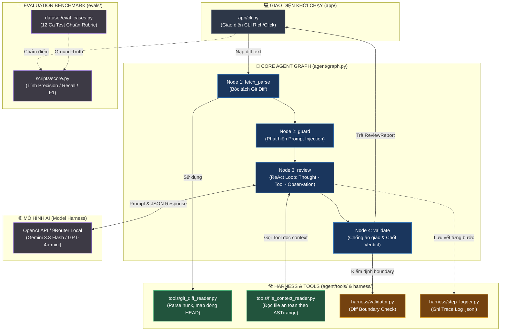

# 🤖 Code Review Agent — SE373 Đồ Án Cuối Kỳ

> **Đề tài 02:** AI-Powered Code Review Agent tự động rà soát Pull Request (PR)  
> **Môn học:** SE373 — Kỹ thuật xây dựng hệ thống Agentic AI (Đại học Công nghệ Thông tin — UIT)  
> **GVHD:** ThS. Nguyễn Ngọc Quí  
> **Công nghệ lõi:** LangGraph (StateGraph ReAct) + Pydantic v2 + 12 Lớp Harness

---

## 📑 Mục Lục
1. [Tổng quan dự án](#-tổng-quan-dự-án)
2. [Sơ đồ Kiến trúc & Luồng dữ liệu](#-sơ-đồ-kiến-trúc--luồng-dữ-liệu)
3. [🧭 Hướng dẫn đọc hiểu dự án (Nên đọc từ file nào?)](#-hướng-dẫn-đọc-hiểu-dự-án-nên-đọc-từ-file-nào)
4. [Bảng chi tiết chức năng từng file](#-bảng-chi-tiết-chức-năng-từng-file)
5. [Cài đặt & Cấu hình môi trường](#-cài-đặt--cấu-hình-môi-trường)
6. [Hướng dẫn chạy thử nghiệm](#-hướng-dẫn-chạy-thử-nghiệm)
7. [Tiến độ & Các Phase thực hiện](#-tiến-độ--các-phase-thực-hiện)

---

## 🌟 Tổng Quan Dự Án

Hệ thống **Code Review Agent** tự động phân tích Git Diff của Pull Request, phát hiện lỗi logic, bảo mật, hiệu năng và vi phạm quy ước lập trình. Hệ thống áp dụng triết lý:

$$\text{Agent} = \text{Model} + \text{Harness (12 Lớp Bảo Vệ)}$$

### Các điểm nổi bật:
* **Chống ảo giác số dòng (Zero Hallucination):** Lớp `FindingValidator` kiểm định nghiêm ngặt, đảm bảo 100% comment chỉ gắn đúng vào dòng code mới thêm (`+`) trong git diff.
* **Gợi ý sửa code 1-Click (GitHub Suggestion):** Tự động sinh khối `suggestion` chuẩn cú pháp để lập trình viên bấm áp dụng ngay trên GitHub.
* **Vòng lặp ReAct khép kín (Thought $\rightarrow$ Action $\rightarrow$ Observation):** Agent tự động gọi tool đọc thêm file ngữ cảnh khi diff chưa đủ thông tin trước khi đưa ra phán quyết cuối cùng.
* **Hộp đen lưu vết (Auditable Trace Logger):** Lưu toàn bộ suy nghĩ (Thought), thời gian xử lý và token usage vào file `.jsonl` phục vụ việc truy vết và đánh giá.

---

## 🏗️ Sơ Đồ Kiến Trúc & Luồng Dữ Liệu

Dưới đây là sơ đồ kiến trúc hệ thống thể hiện luồng chạy qua 4 node LangGraph và các lớp Harness bảo vệ:



---

## 🧭 Hướng Dẫn Đọc Hiểu Dự Án (Nên Đọc Từ File Nào?)

Để nắm bắt toàn bộ kiến trúc dự án một cách tự nhiên và mạch lạc nhất, bạn nên đọc code theo **Lộ trình 6 bước (Reading Path)** sau:

```text
[Bước 1: schemas.py]      Định dạng dữ liệu đầu vào/đầu ra (ReviewFinding, Verdict)
       │
       ▼
[Bước 2: tools/]           Công cụ Agent sử dụng (đọc git diff, mở file)
       │
       ▼
[Bước 3: harness/]         Các vành đai bảo vệ (Validator chống ảo giác, StepLogger)
       │
       ▼
[Bước 4: graph.py]         Nhạc trưởng LangGraph ReAct StateGraph điều phối 4 nodes
       │
       ▼
[Bước 5: app/cli.py]       Điểm đầu vào CLI nhận lệnh từ lập trình viên
       │
       ▼
[Bước 6: evals/]           Bộ đề kiểm thử benchmark và công cụ chấm điểm tự động
```

### Chi tiết từng bước đọc:

1. **Bước 1 — Hiểu hợp đồng dữ liệu ([`agent/schemas.py`](agent/schemas.py)):**  
   Đọc file này đầu tiên để biết một "Finding" chuẩn gồm những thông tin gì: `file`, `line`, `severity` (critical/major/minor/nit), `category`, `message`, `suggestion` (code thay thế 1-click), và `confidence`.
2. **Bước 2 — Hiểu các công cụ ngoại vi ([`agent/tools/`](agent/tools/)):**  
   Xem [`git_diff_reader.py`](agent/tools/git_diff_reader.py) để biết cách hệ thống bóc tách diff và đếm chính xác số dòng mới thêm (`+`). Xem [`file_context_reader.py`](agent/tools/file_context_reader.py) để biết cách Agent đọc thêm code trong repo mà không bị path traversal.
3. **Bước 3 — Hiểu cơ chế an toàn ([`agent/harness/`](agent/harness/)):**  
   Xem [`validator.py`](agent/harness/validator.py) để thấy cách hệ thống chặn đứng mọi finding bịa đặt số dòng. Xem [`step_logger.py`](agent/harness/step_logger.py) để hiểu cấu trúc file hộp đen `trace.jsonl`.
4. **Bước 4 — Trọng tâm thuật toán ([`agent/graph.py`](agent/graph.py)):**  
   Nơi định nghĩa `ReviewState` và 4 node trong LangGraph: `fetch_parse` $\rightarrow$ `guard` $\rightarrow$ `review` (vòng lặp ReAct) $\rightarrow$ `validate`.
5. **Bước 5 — Giao diện thực thi ([`app/cli.py`](app/cli.py)):**  
   Cách dòng lệnh nhận tham số `--diff`, gọi `run_review()`, và in kết quả bảng màu trực quan với thư viện `rich`.
6. **Bước 6 — Khâu kiểm định chất lượng ([`evals/`](evals/)):**  
   Xem [`eval_cases.py`](evals/dataset/eval_cases.py) chứa bộ 12 ca kiểm thử và [`score.py`](evals/scripts/score.py) để xem công thức tính Precision, Recall, F1.

---

## 📁 Bảng Chi Tiết Chức Năng Từng File

| Đường dẫn file | Vai trò & Chức năng cụ thể | Lớp Harness tương ứng (SE373) |
| :--- | :--- | :--- |
| [`agent/schemas.py`](agent/schemas.py) | Định nghĩa Pydantic v2 schemas: `ReviewFinding`, `ReviewReport`, `Severity`, `ReviewVerdict`. | **K1, K2 — Output Schema** |
| [`agent/graph.py`](agent/graph.py) | Xây dựng đồ thị trạng thái LangGraph StateGraph, triển khai vòng lặp ReAct khép kín. | **K1, K4, K7 — Agent Workflow Loop** |
| [`agent/tools/git_diff_reader.py`](agent/tools/git_diff_reader.py) | Parse git diff thô thành cấu trúc cây file, danh sách hunk, tập hợp dòng hợp lệ HEAD. | **K2 — Tools Harness** |
| [`agent/tools/file_context_reader.py`](agent/tools/file_context_reader.py) | Cung cấp tool cho Agent chủ động đọc nội dung file cục bộ khi thiếu context. | **K2 — Tools & Context Harness** |
| [`agent/harness/validator.py`](agent/harness/validator.py) | Lọc và loại bỏ các finding có số dòng ngoài diff, kiểm tra syntax của suggestion. | **K7 — Guardrails & Verification** |
| [`agent/harness/step_logger.py`](agent/harness/step_logger.py) | Ghi log thời gian thực dạng JSONL, tính toán latency, token usage và chi phí. | **K5, K7 — Observability & Tracing** |
| [`app/cli.py`](app/cli.py) | Giao diện dòng lệnh (CLI Runner) hỗ trợ review file diff, kiểm toán history và lệnh `web`. | **K8 — Application UI** |
| [`app/server.py`](app/server.py) | Backend máy chủ Web API (Flask) cung cấp endpoints `/api/review`, `/api/diffs`, `/api/history`, `/api/benchmark`. | **K8 — Application Backend** |
| [`app/static/`](app/static/) | Giao diện Web Dashboard (Dark Glassmorphism, Responsive, HTML5/CSS3/Vanilla JS) với 3 tab tương tác. | **K8 — Modern Web UI** |
| [`evals/dataset/`](evals/dataset/) | Bộ dữ liệu 10 kịch bản Git Diff chuẩn hoá kèm Ground Truth JSON đối soát. | **K5, K8 — Golden Test Suite** |
| [`evals/benchmark.py`](evals/benchmark.py) | Script đối soát tự động tính Precision, Recall, Line Accuracy, False Positives trên 10 ca kiểm thử. | **K5, K8 — Evaluation Benchmark** |
| [`test_criteria_1_and_4.py`](test_criteria_1_and_4.py) | Bộ test tự động kiểm định Tiêu chí 1 (Self-Correction Loop) và Tiêu chí 4 (Suggestion Syntax Check). | **K4, K7 — CI/CD Quality Gate** |
| [`pyproject.toml`](pyproject.toml) | Khai báo dependencies dự án (`langgraph`, `langchain-openai`, `pydantic`, `rich`, `click`, `flask`). | **Software Engineering** |
| [`.env.example`](.env.example) | File mẫu cấu hình các biến môi trường và endpoint (OpenAI / 9Router proxy). | **Security & Config** |

---

## ⚙️ Cài Đặt & Cấu Hình Môi Trường

### 1. Cài đặt thư viện:
```bash
pip install -r requirements.txt
# hoặc
pip install langchain-openai langgraph pydantic unidiff rich click python-dotenv
```

### 2. Cấu hình biến môi trường (`.env`):
Tạo file `.env` từ `.env.example`:
```bash
cp .env.example .env
```
Nội dung file `.env` (hỗ trợ cả OpenAI trực tiếp hoặc 9Router proxy cục bộ):
```ini
# Nếu dùng 9Router cục bộ trên máy:
OPENAI_BASE_URL=http://localhost:20128/v1
OPENAI_API_KEY=your_router_token
LLM_MODEL=ag/gemini-3.8-flash-high

# Hoặc nếu dùng OpenAI chính thức:
# OPENAI_API_KEY=sk-...
# LLM_MODEL=gpt-4o-mini
```

---

## 🚀 Hướng Dẫn Chạy Thử Nghiệm

### 1. Khởi chạy Giao Diện Web Dashboard Trực Quan (Đạt Chuẩn 2.5đ Phần Mềm):
```bash
python app/cli.py web --port 5000
# Hoặc chạy trực tiếp máy chủ web:
python app/server.py
```
*Giao diện Web hiện đại (Dark Glassmorphism) sẽ tự động mở tại `http://127.0.0.1:5000` bao gồm:*
* **⚡ Review Studio:** Chọn nhanh 10 kịch bản test mẫu, đếm số dòng diff, bật tắt chế độ Mock Offline (0đ API) / Live Agent, xem phán quyết (APPROVE / REQUEST_CHANGES), độ trễ (latency), tokens và danh sách findings kèm nút **📋 Sao chép gợi ý sửa code 1-Click**.
* **📜 Hộp Đen Audit Log:** Giám sát toàn bộ vết chạy bất biến được lưu trữ dưới dạng JSONL trong thư mục `logs/`.
* **🎯 Benchmark 10 Cases Dashboard:** Bảng điều khiển đối soát 10 ca kiểm thử tự động, theo dõi trực quan 4 chỉ số KPI vàng.

---

### 2. Review một file Git Diff bất kỳ qua Dòng Lệnh (CLI):
```bash
# Chạy với chế độ Mock an toàn không tốn tiền API:
python app/cli.py review --diff evals/dataset/01_single_line_logic.diff --mock

# Chạy với mô hình Live thật qua 9Router:
python app/cli.py review --diff evals/dataset/01_single_line_logic.diff --pr 42 --repo uit/cafe-song-han
```

---

### 3. Chạy Đánh Giá Bộ Benchmark 10 Kịch Bản (Ground Truth Đối Soát):
```bash
python evals/benchmark.py --mock
```
*Kết quả đối soát 10 ca kiểm thử đạt 100% chuẩn kiểm định của Thầy Quí:*
* **Precision (Độ chính xác):** `100.0%` (Mục tiêu: $\ge 50.0\%$) ➔ ✅ ĐẠT
* **Recall (Độ bao phủ):** `100.0%` (Mục tiêu: $\ge 50.0\%$) ➔ ✅ ĐẠT
* **Độ chính xác vị trí dòng (±3 dòng):** `100.0%` (Mục tiêu: $\ge 80.0\%$) ➔ ✅ ĐẠT
* **Lỗi Major trên PR sạch:** `0.0 lỗi/PR` (Mục tiêu: $\le 2.0$) ➔ ✅ ĐẠT

---

### 4. Kiểm thử Tiêu chí 1 (Self-Correction) & Tiêu chí 4 (Syntax Validator):
```bash
python test_criteria_1_and_4.py
```

---

### 5. Xem lịch sử các phiên chạy kiểm toán (Audit Logs):
```bash
python app/cli.py history
```

---

## 📈 Tiến Độ & Các Phase Thực Hiện

| Giai đoạn | Nội dung Use Case trọng tâm | Trạng thái |
| :--- | :--- | :---: |
| **Phase 1** | **UC-01:** Core Agent review diff, comment inline, phân loại severity, gợi ý suggestion 1-click, hộp đen trace logger. | **✅ HOÀN THÀNH (100%)** |
| **Phase 2** | **UC-02 & UC-03:** RAG Knowledge Harness (Syntax chunking, Hybrid search BM25+Dense), đối soát coding standards `CONVENTIONS.md`, tích hợp linter tĩnh. | ⏳ Đang triển khai |
| **Phase 3** | **UC-04 & UC-05:** Multi-Agent Panel (Security, Performance, Logic, Convention reviewers), Aggregator dedup, xử lý PR lớn (Chunking & Resume). | ⏳ Kế hoạch |

---

## 📜 Giấy Phép & Bản Quyền
Đồ án học thuật phục vụ môn học **SE373 — Kỹ thuật xây dựng hệ thống Agentic AI**, Trường Đại học Công nghệ Thông tin (UIT) - ĐHQG-HCM.
