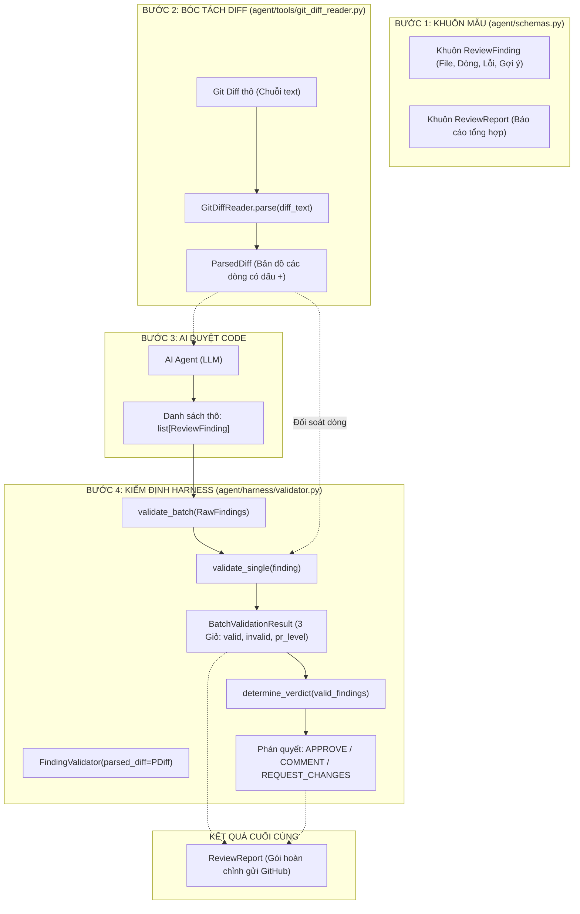
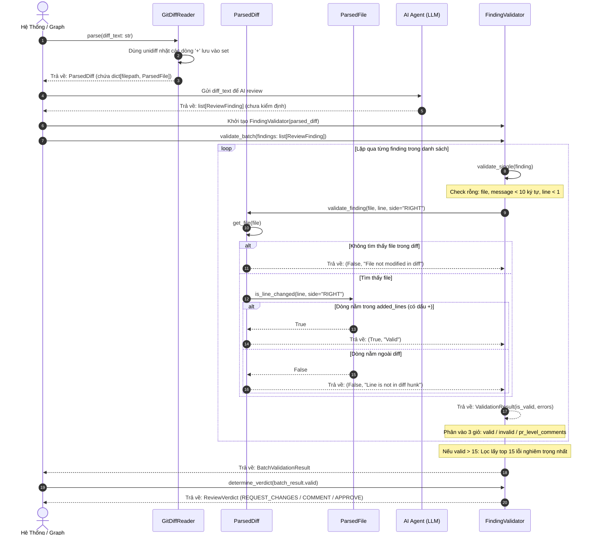

# 🗺️ SƠ ĐỒ TOÀN CẢNH PIPELINE (STEP 1 + STEP 2 + STEP 3)

Tài liệu này tổng hợp chi tiết mối liên hệ giữa 3 file:
1. `agent/schemas.py` (Khuôn mẫu dữ liệu)
2. `agent/tools/git_diff_reader.py` (Công cụ bóc tách Git Diff)
3. `agent/harness/validator.py` (Cổng an ninh kiểm định)

---

## 1. Sơ đồ Luồng Dữ Liệu (Data Flow)

---

## 2. Sơ Đồ Tuần Tự (Sequence Diagram: Hàm nào gọi hàm nào)

---

## 3. Bảng Tra Cứu Toàn Bộ Hàm & Trách Nhiệm

| File | Tên Hàm / Thuộc tính | Đầu vào (Input) | Đầu ra (Output) | Chức năng chính |
| :--- | :--- | :--- | :--- | :--- |
| `agent/schemas.py` | `ReviewFinding` | Data fields | `ReviewFinding` object | Khuôn mẫu 1 lỗi (tự validate line >= 1) |
| `agent/schemas.py` | `ReviewReport` | Data fields | `ReviewReport` object | Khuôn mẫu báo cáo tổng PR |
| `agent/tools/git_diff_reader.py` | `GitDiffReader.parse()` | `diff_text: str` | `ParsedDiff` | Bóc tách diff thành danh sách các dòng dấu `+` |
| `agent/tools/git_diff_reader.py` | `ParsedFile.is_line_changed()` | `line: int` | `bool` | Kiểm tra nhanh số dòng có nằm trong `added_lines` không |
| `agent/tools/git_diff_reader.py` | `ParsedDiff.validate_finding()` | `file: str, line: int` | `tuple[bool, str]` | Xác nhận dòng code AI chỉ có nằm trong diff không |
| `agent/harness/validator.py` | `FindingValidator.validate_single()` | `ReviewFinding` | `ValidationResult` | Kiểm tra 1 finding (rỗng, ngắn, lệch diff) |
| `agent/harness/validator.py` | `FindingValidator.validate_batch()` | `list[ReviewFinding]` | `BatchValidationResult` | Phân 3 giỏ (`valid`, `invalid`, `pr_level`) + cắt top 15 |
| `agent/harness/validator.py` | `FindingValidator.determine_verdict()` | `list[ReviewFinding]` | `ReviewVerdict` | Quyết định `APPROVE`, `COMMENT`, hay `REQUEST_CHANGES` |
