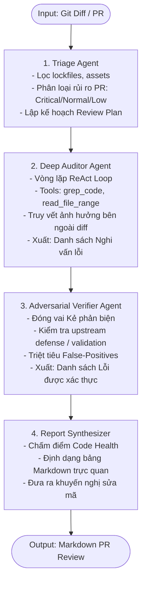
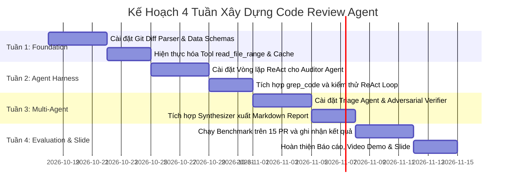

# BÁO CÁO THIẾT KẾ VÀ KẾ HOẠCH TRIỂN KHAI HỆ THỐNG CODE REVIEW AGENT TỰ CHỦ
*(Autonomous Code Review Agent System — Architecture & Implementation Blueprint)*

> **Đồ án môn học**: Kỹ thuật AI Agentic (Agentic AI Engineering) — Trường Đại học Công nghệ Thông tin (UIT)  
> **Chủ đề**: Xây dựng Hệ thống Code Review Agent Đa Tác tử Tự chủ  
> **Mục tiêu**: Giải quyết bài toán mù ngữ cảnh (Context Blindness) và cảnh báo rác (False-Positives) của các công cụ AI review thông thường.  

---

## MỤC LỤC
1. [Tổng Quan Đề Tài & Bài Toán Cần Giải Quyết](#1-tổng-quan-đề-tài--bài-toán-cần-giải-quyết)
2. [Kiến Trúc Kỹ Thuật & Cấu Trúc Thư Mục Dự Án](#2-kiến-trúc-kỹ-thuật--cấu-trúc-thư-mục-dự-án)
3. [Tầng Công Cụ (Tools Layer) & Quản Lý Bộ Nhớ Ngữ Cảnh](#3-tầng-công-cụ-tools-layer--quản-lý-bộ-nhớ-ngữ-cảnh)
4. [Thiết Kế Luồng Multi-Agent (4-Stage State Graph)](#4-thiết-kế-luồng-multi-agent-4-stage-state-graph)
5. [Đặc Tả Dữ Liệu (Schemas) & System Prompts Chuẩn Hóa](#5-đặc-tả-dữ-liệu-schemas--system-prompts-chuẩn-hóa)
6. [Phương Pháp Đánh Giá Định Lượng (Benchmark & Metrics)](#6-phương-pháp-đánh-giá-định-lượng-benchmark--metrics)
7. [Lộ Trình Triển Khai 4 Tuần & Chiến Lược Bảo Vệ](#7-lộ-trình-triển-khai-4-tuần--chiến-lược-bảo-vệ)

---

## 1. TỔNG QUAN ĐỀ TÀI & BÀI TOÁN CẦN GIẢI QUYẾT

### 1.1. Hạn chế của mô hình AI Code Review truyền thống (Naive LLM Wrapper)
Hầu hết các giải pháp hiện nay chỉ đơn thuần lấy `git diff` đưa vào prompt LLM với câu lệnh *"Hãy review đoạn code này"*. Phương pháp này tồn tại 3 nhược điểm chí mạng:
1. **Mù ngữ cảnh diện rộng (Context Blindness)**: LLM chỉ thấy các dòng bị sửa trong diff mà không thấy các file khác đang gọi hàm đó, dẫn đến bỏ sót các lỗi phá vỡ tương thích (Breaking Changes).
2. **Tỷ lệ báo lỗi giả cao (High False-Positive Rate)**: LLM thường xuyên bắt bẻ các lỗi không có thật (ví dụ: cảnh báo thiếu validate trong khi hàm middleware phía trước đã xử lý rồi).
3. **Nhận xét mơ hồ, thiếu bằng chứng (Vague Feedback)**: Đưa ra các lời khuyên chung chung như *"Nên tối ưu hiệu năng"*, *"Cần thêm try/catch"* mà không có kịch bản kích hoạt lỗi cụ thể.

### 1.2. Mục tiêu của Autonomous Code Review Agent
Xây dựng một hệ sinh thái Agentic có khả năng:
* **Chủ động khám phá (Active Exploration)**: Tự động dùng công cụ tìm kiếm (`grep`, `range read`) để truy vết tác động ra ngoài phạm vi `git diff`.
* **Tự phản biện diệt lỗi giả (Adversarial Verification)**: Sử dụng tác tử độc lập đóng vai "Kẻ phản biện" để kiểm chứng và gạch bỏ các cảnh báo sai.
* **Đưa ra bằng chứng xác thực (Evidence-based Contract)**: Mọi kết luận lỗi phải đi kèm kịch bản kích hoạt và đoạn mã chứng minh.

---

## 2. KIẾN TRÚC KỸ THUẬT & CẤU TRÚC THƯ MỤC DỰ ÁN

### 2.1. Ngăn xếp Công nghệ (Tech Stack)
* **Ngôn ngữ thực hiện**: Python 3.11+.
* **Orchestration Framework**: **LangGraph** (xây dựng State Machine có chu trình, dễ trực quan hóa biểu đồ trạng thái khi báo cáo).
* **LLM Abstraction Layer**: **LiteLLM** (hỗ trợ chuyển đổi linh hoạt giữa Gemini, Claude, OpenAI và Ollama local).
* **Mô hình triển khai đa tầng (Multi-tier LLM Strategy)**:
  * *Tầng Triage (Nhanh/Rẻ)*: Gemini 2.5/3 Flash hoặc GPT-4o-mini (lọc file, phân loại rủi ro).
  * *Tầng Auditor & Verifier (Suy luận sâu)*: Claude 3.5/3.7 Sonnet hoặc GPT-4o (đọc hiểu kiến trúc, phản biện logic phức tạp).

### 2.2. Cấu trúc thư mục mã nguồn chuẩn (Clean Architecture)
```text
code-review-agent/
├── pyproject.toml               # Quản lý phụ thuộc dự án (poetry / pip)
├── README.md                    # Tài liệu hướng dẫn cài đặt và demo
├── config/
│   └── settings.yaml            # Cấu hình Token Budget, Timeout, Rule Sets
├── src/
│   ├── main.py                  # Entrypoint CLI chính của công cụ
│   ├── harness/                 # Bộ khung điều khiển & quản lý ngữ cảnh
│   │   ├── runner.py            # Vòng lặp ReAct Loop
│   │   ├── context_manager.py   # Token Counter, Windowing, FileStateCache
│   │   └── prompt_caching.py    # Phân tách Prompt tĩnh (Static) & động (Dynamic)
│   ├── agents/                  # Các Node Agent độc lập
│   │   ├── triage_agent.py      # Lọc file rác, đánh giá độ rủi ro PR
│   │   ├── auditor_agent.py     # ReAct Agent điều tra và phát hiện lỗi
│   │   ├── verifier_agent.py    # Adversarial Agent phản biện diệt lỗi giả
│   │   └── synthesizer.py       # Định dạng báo cáo Markdown / GitHub Comment
│   ├── tools/                   # Tầng công cụ an toàn (Read-Only Tools)
│   │   ├── git_tools.py         # Parser git diff & commit metadata
│   │   ├── file_tools.py        # Đọc file theo dòng kèm cache hash
│   │   └── grep_tools.py        # Tìm kiếm regex/ripgrep toàn bộ codebase
│   ├── schemas/                 # Pydantic Schemas định nghĩa hợp đồng dữ liệu
│   │   ├── pr_schema.py         # Cấu trúc PR, files, diff hunks
│   │   └── issue_schema.py      # Cấu trúc Issue (bắt buộc có evidence)
│   └── prompts/                 # System Prompts chuẩn hóa
│       ├── triage_prompt.py
│       ├── auditor_prompt.py
│       └── verifier_prompt.py
├── benchmark/                   # Bộ dữ liệu thử nghiệm & đo lường
│   ├── ground_truth.json        # 15 PRs mẫu kèm nhãn lỗi thực tế
│   └── run_eval.py              # Script đo Precision, Recall, FPR
└── tests/                       # Unit tests
```

---

## 3. TẦNG CÔNG CỤ (TOOLS LAYER) & QUẢN LÝ BỘ NHỚ NGỮ CẢNH

Hệ thống hoạt động theo nguyên tắc **Read-Only By Design** (Tuyệt đối không cấp tool sửa file hay chạy lệnh shell tự do).

### 3.1. Tool `read_file_range` (Đọc file có chọn lọc kèm Cache)
* Không load toàn bộ file vào prompt; bắt buộc giới hạn bằng `start_line` và `end_line`.
* Đánh số thứ tự dòng theo chuẩn `cat -n` bắt đầu từ dòng 1.
* **Cơ chế `FileStateCache`**: Lưu bảng băm SHA-256 của các file đã đọc trong phiên. Nếu Agent gọi đọc lại file mà nội dung không đổi, tool trả về thông điệp ngắn gọn: *"File unchanged. Refer to previous result"* để tiết kiệm token.

```python
import hashlib
from typing import Dict

class FileStateCache:
    def __init__(self):
        self._cache: Dict[str, str] = {} # file_path -> sha256_hash

    def get_content_or_stub(self, file_path: str, start_line: int, end_line: int) -> str:
        with open(file_path, "r", encoding="utf-8", errors="ignore") as f:
            lines = f.readlines()
        
        content_slice = lines[max(0, start_line - 1):end_line]
        numbered_output = "".join(f"{i + start_line}: {line}" for i, line in enumerate(content_slice))
        return numbered_output
```

### 3.2. Tool `grep_code` (Truy vết hàm gọi diện rộng)
Cho phép Agent tìm kiếm tất cả các nơi đang sử dụng một hàm, biến hoặc interface bị sửa đổi trong diff:

```python
import subprocess

def grep_code(query: str, repo_dir: str, file_pattern: str = "*") -> str:
    """Agent dùng tool này để tìm các caller nằm ngoài file diff."""
    cmd = ["rg", "-n", "--max-count", "25", "-g", file_pattern, query, repo_dir]
    try:
        res = subprocess.run(cmd, capture_output=True, text=True, check=False)
        return res.stdout if res.stdout else "No matches found."
    except Exception as e:
        return f"Grep execution error: {str(e)}"
```

---

## 4. THIẾT KẾ LUỒNG MULTI-AGENT (4-STAGE STATE GRAPH)



### Chi tiết 4 Node trong State Graph:
1. **Node 1: Triage Agent**:
   * Đọc danh sách file sửa đổi trong PR.
   * Lọc bỏ file rác (`package-lock.json`, hình ảnh, văn bản tài liệu).
   * Gán nhãn độ ưu tiên (nếu sửa đổi code thanh toán, bảo mật, xác thực -> gán nhãn `CRITICAL`).
2. **Node 2: Deep Auditor Agent (Vòng lặp ReAct)**:
   * Chạy chu trình suy luận: `Thought -> Action (Call Tool) -> Observation`.
   * Khi thấy hàm `update_user_role()` bị đổi tham số:
     * Tự động gọi `grep_code("update_user_role")`.
     * Đọc các file liên quan bằng `read_file_range`.
     * Phát hiện nơi gọi cũ bị vỡ -> Tạo `CandidateIssue`.
3. **Node 3: Adversarial Verifier Agent (Bộ lọc diệt lỗi giả)**:
   * Nhận `CandidateIssue` từ Auditor.
   * Cố gắng tìm lý do bác bỏ: Kiểm tra middleware đã chặn chưa, schema database có ràng buộc chưa.
   * Nếu có bằng chứng đã được bảo vệ -> **Bác bỏ (Drop Issue)**.
   * Nếu không thể bác bỏ và có kịch bản gây lỗi rõ ràng -> **Xác nhận (Confirm Issue)**.
4. **Node 4: Report Synthesizer**:
   * Tổng hợp kết quả thành báo cáo Markdown hoàn chỉnh, chuẩn hóa code block dạng diff để lập trình viên dễ áp dụng.

---

## 5. ĐẶC TẢ DỮ LIỆU (SCHEMAS) & SYSTEM PROMPTS CHUẨN HÓA

### 5.1. Pydantic Schemas (Ràng buộc đầu ra có bằng chứng)

```python
from pydantic import BaseModel, Field
from typing import List, Optional

class CandidateIssue(BaseModel):
    file_path: str = Field(description="Đường dẫn file xảy ra vấn đề")
    line_start: int = Field(description="Dòng bắt đầu")
    line_end: int = Field(description="Dòng kết thúc")
    severity: str = Field(description="CRITICAL | HIGH | MEDIUM | LOW | SUGGESTION")
    category: str = Field(description="SECURITY | BUG | PERFORMANCE | BREAKING_CHANGE")
    title: str = Field(description="Tiêu đề ngắn gọn của lỗi")
    evidence_snippet: str = Field(description="Đoạn code nguyên văn gây ra lỗi")
    failure_scenario: str = Field(description="Kịch bản kích hoạt lỗi cụ thể")
    suggested_fix: str = Field(description="Đoạn mã đề xuất sửa đổi")

class ReviewSummary(BaseModel):
    health_score: str = Field(description="Điểm sức khỏe mã nguồn: A | B | C | D | F")
    critical_count: int
    warning_count: int
    verified_issues: List[CandidateIssue]
```

### 5.2. System Prompt mẫu cho Adversarial Verifier

```text
You are an Adversarial Code Review Verifier. Your role is NOT to confirm issues, but to DISPROVE them and eliminate False Positives.

=== YOUR STRICT VERIFICATION PROTOCOL ===
1. RECOGNIZE RATIONALIZATIONS:
   - LLMs often hallucinate missing validation or null-pointer risks.
   - Do NOT accept an issue just because it sounds plausible on paper.
2. CHECK UPSTREAM DEFENSES:
   - Use `grep_code` to verify if the input is already sanitized by a global middleware, framework interceptor, or API gateway.
   - Check if database schemas or type definitions enforce constraints that make this issue impossible.
3. CONCRETE PROOF REQUIREMENT:
   - For an issue to be marked as VALID, you must identify a concrete, reproducible failure scenario (e.g., exact inputs causing crash or exploit).
   - If an issue is already handled elsewhere or is purely a stylistic preference, REJECT it immediately with justification.
```

---

## 6. PHƯƠNG PHÁP ĐÁNH GIÁ ĐỊNH LƯỢNG (BENCHMARK & METRICS)

Để đạt điểm tuyệt đối trước Hội đồng chấm đồ án UIT, hệ thống bắt buộc phải có phần thực nghiệm định lượng thay vì chỉ demo cảm tính.

### 6.1. Xây dựng Tập dữ liệu Benchmark (15 Pull Requests chuẩn)
* **5 PR Clean**: Code sạch, không có lỗi (Dùng để kiểm thử: Agent có bị ảo giác báo lỗi sai không?).
* **5 PR Breaking Changes / Logic Flaws**: Đổi tên hàm hoặc thay đổi kiểu dữ liệu tham số làm hỏng các file ngoài diff (Dùng để kiểm thử năng lực Active Exploration).
* **5 PR Security Vulnerabilities**: Chứa lỗi bảo mật phổ biến (SQL Injection, IDOR, Race Condition, Thiếu Authorization).

### 6.2. Các chỉ số đo lường cốt lõi (Evaluation Metrics)

$$\text{Precision} = \frac{\text{Số lỗi thật Agent phát hiện đúng}}{\text{Tổng số lỗi Agent đã cảnh báo}} \quad (\text{Mục tiêu: } > 80\%)$$

$$\text{Recall} = \frac{\text{Số lỗi thật Agent phát hiện đúng}}{\text{Tổng số lỗi thực tế có trong Benchmark}} \quad (\text{Mục tiêu: } > 75\%)$$

$$\text{False Positive Rate (FPR)} = \frac{\text{Số cảnh báo sai}}{\text{Tổng số cảnh báo}} \quad (\text{Mục tiêu: } < 15\%)$$

$$\text{Token Savings} = \frac{\text{Token dùng bởi Range Read \& Cache}}{\text{Token đọc toàn bộ file thô}} \times 100\% \quad (\text{Mục tiêu tiết kiệm: } > 60\%)$$

---

## 7. LỘ TRÌNH TRIỂN KHAI 4 TUẦN & CHIẾN LƯỢC BẢO VỆ



### 3 Điểm nhấn giúp đồ án đạt điểm tối đa trước Hội đồng:
1. **Điểm nhấn "Diệt False-Positive"**: Chứng minh rằng Verifier Agent giúp giảm tỷ lệ cảnh báo rác từ ~45% (ở mô hình đơn Agent) xuống dưới 15% (ở mô hình đa Agent phản biện).
2. **Điểm nhấn "Active Tracing"**: Trình diễn video ca kiểm thử Agent tự động lần ra bug ở file controller cách xa file diff hàng trăm dòng code nhờ `grep_code`.
3. **Điểm nhấn "Context Optimization"**: Đưa ra biểu đồ chứng minh cơ chế đọc theo phạm vi dòng (`read_file_range`) và cache hash giúp tiết kiệm hơn 60% chi phí token API.

---
*Tài liệu kỹ thuật nội bộ phục vụ hoàn thiện đồ án Kỹ thuật AI Agentic.*
